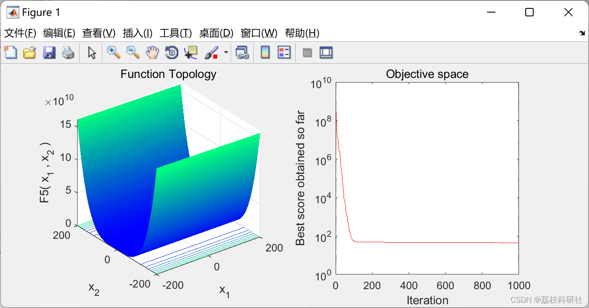
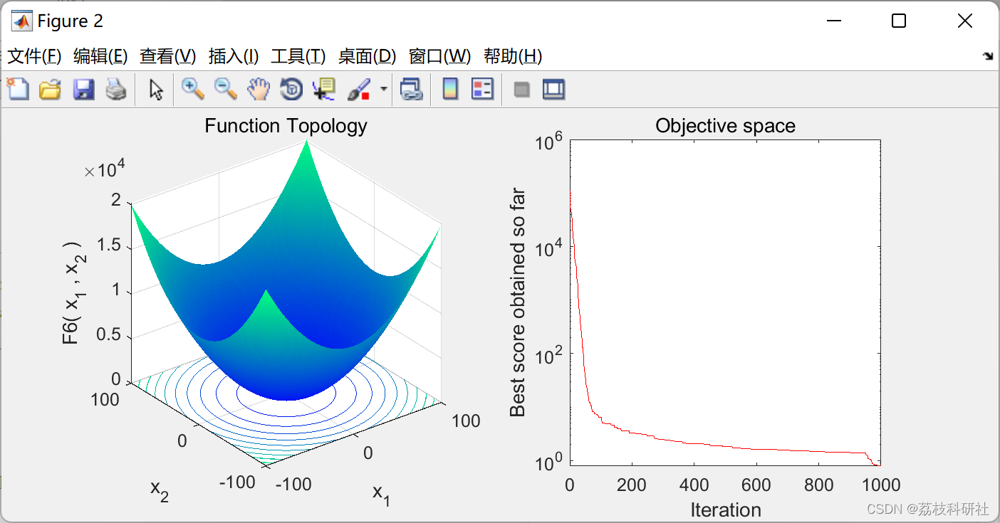
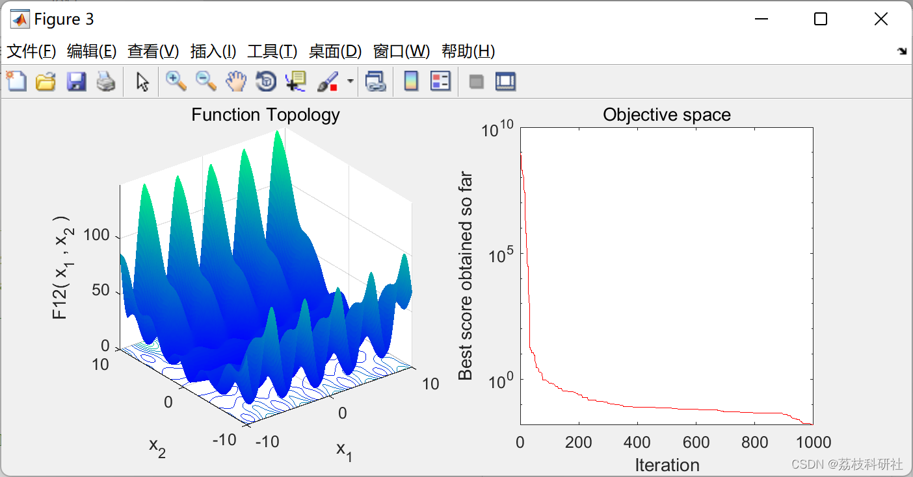
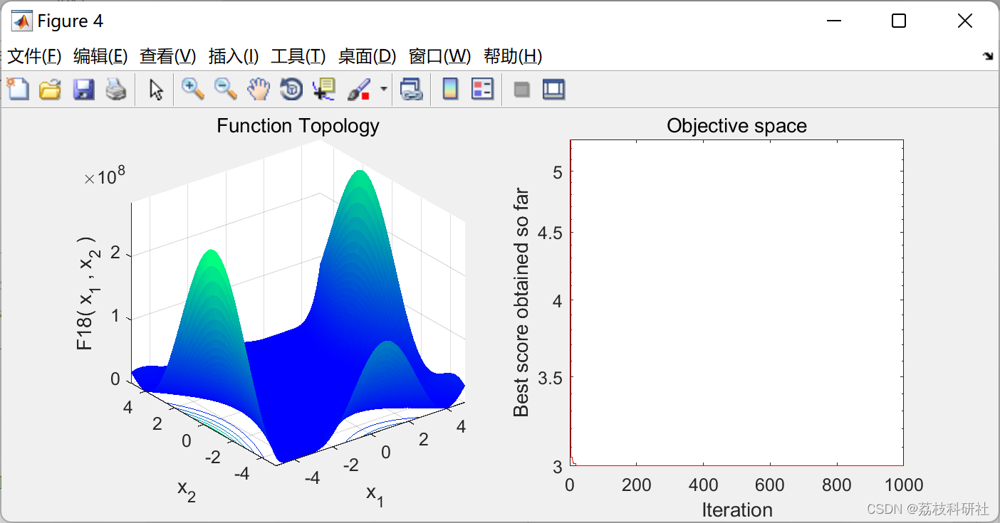
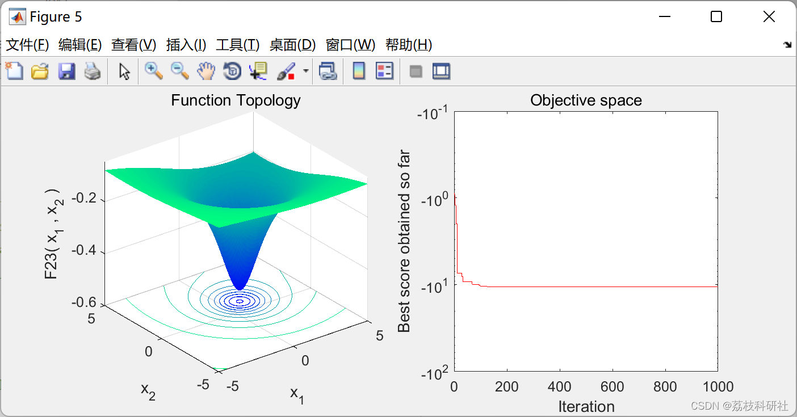

# Spotted Deer Optimization Algorithm (Matlab Code Implementation)

​  
📚2 Running Results Editing
Editor
Editor
Editor
Editor
Part of the code:
function [Top_gazelle_fit,Top_gazelle_pos,Convergence_curve]=GOA2(SearchAgents_no,Max_iter,lb,ub,dim,fobj)  
Top_gazelle_pos=zeros(1,dim);  
Top_gazelle_fit=inf;  
Convergence_curve=zeros(1,Max_iter);  
stepsize=zeros(SearchAgents_no,dim);  
fitness=inf(SearchAgents_no,1);  
gazelle=initialization(SearchAgents_no,dim,ub,lb);  
Xmin=repmat(ones(1,dim).*lb,SearchAgents_no,1);  
Xmax=repmat(ones(1,dim).*ub,SearchAgents_no,1);  
Iter=0;  
PSRs=0.34;  
S=0.88;  
s=rand();  
while Iter<Max_iter  
%------------------- Evaluating top gazelle -----------------  
for i=1:size(gazelle,1)  
Flag4ub=gazelle(i,:)>ub;  
Flag4lb=gazelle(i,:)<lb;  
gazelle(i,:)=(gazelle(i,:).*(~(Flag4ub+Flag4lb)))+ub.*Flag4ub+lb.*Flag4lb;  
fitness(i,1)=fobj(gazelle(i,:));  
if fitness(i,1)<Top_gazelle_fit  
Top_gazelle_fit=fitness(i,1);  
Top_gazelle_pos=gazelle(i,:);  
end  
end  
%------------------- Keeping tract of fitness values-------------------  
if Iter==0  
fit_old=fitness;  Prey_old=gazelle;  
end  
Inx=(fit_old<fitness);  
Indx=repmat(Inx,1,dim);  
gazelle=Indx.*Prey_old+~Indx.*gazelle;  
fitness=Inx.*fit_old+~Inx.*fitness;  
fit_old=fitness;  Prey_old=gazelle;  
%------------------------------------------------------------  
Elite=repmat(Top_gazelle_pos,SearchAgents_no,1); %(Eq. 3)  
CF=(1-Iter/Max_iter)^(2*Iter/Max_iter);  
RL=0.05*levy(SearchAgents_no,dim,1.5); %Levy random number vector  
RB=randn(SearchAgents_no,dim);     %Brownian random number vector  
for i=1:size(gazelle,1)  
for j=1:size(gazelle,2)  
R=rand();  
r=rand();  
if mod(Iter,2)==0  
mu=-1;  
else  
mu=1;  
end  
%------------------ Exploitation -------------------  
if r>0.5  
stepsize(i,j)=RB(i,j)*(Elite(i,j)-RB(i,j)*gazelle(i,j));  
gazelle(i,j)=gazelle(i,j)+s*R*stepsize(i,j);  
%--------------- Exploration----------------  
else  
if i>size(gazelle,1)/2  
stepsize(i,j)=RB(i,j)*(RL(i,j)*Elite(i,j)-gazelle(i,j));  
gazelle(i,j)=Elite(i,j)+S*mu*CF*stepsize(i,j);  
🎉3 References
[2] Agushaka, J.O., Ezugwu, A.E. & Abualigah, L. Gazelle optimization algorithm: a novel nature-inspired metaheuristic optimizer. Neural Comput & Applic (2022). https://doi.org/10.1007/s00521-022-07854-6  
🌈4 Matlab code implementation

## Images

<!-- PAYMENT_BLOCK -->

## Get this dataset

- Payment link (Stripe): [Buy now](https://buy.stripe.com/3cs8yP7sY87d0vu9AB)
- Payment QR code: 

<!-- /PAYMENT_BLOCK -->
